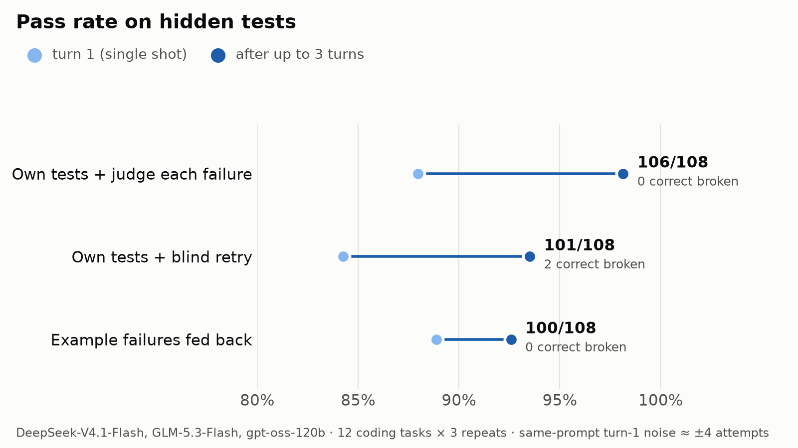

# agent-lab

Small, reproducible experiments on how open-model agents behave. Each one asks a single question,
runs it on Sail Research's API, and keeps the raw responses in `runs/` so every number can be checked.

## Experiment 1: which feedback loop helps a model fix its own code?



12 coding tasks, each with a spec, public examples the model sees, and hidden tests it never sees.
3 models (GLM-5.3-Flash, DeepSeek-V4.1-Flash, gpt-oss-120b) x 3 repeats, up to 3 turns per attempt.
Every turn is graded on the hidden tests, so turn 1 and the final turn come from the same attempt.

| harness | turn 1 | final | fixed | broken |
|---|---|---|---|---|
| example failures fed back | 96/108 | 100/108 | 4 | 0 |
| own tests first, model judges each failure | 95/108 | 106/108 | 11 | 0 |
| own tests first, blind retry on failure | 91/108 | 101/108 | 12 | 2 |

Caveats: the task set is small and DeepSeek passes everything, turn 1 varies by about 4/108 between runs
of the same prompt, and the self-test harnesses cost about 3.5x the tokens of the example harness.

## Files

- `tasks.py`: the 12 tasks, graders, and test runners. `uv run tasks.py` self-checks every grader.
- `run.py`: the harness. `--harness examples | selftest | resample`.
- `plot.py`: rebuilds the chart from run files.
- `bench.py`: one prompt timed on Sail's `asap` and `balanced` completion windows.

## Run

```bash
export SAIL_API_KEY=...   # https://app.sailresearch.com/api-keys
uv run tasks.py
uv run run.py --harness selftest --models zai-org/GLM-5.3-Flash --repeats 1 -k semver
uv run plot.py runs/*_asap.jsonl -o harnesses.png
```
