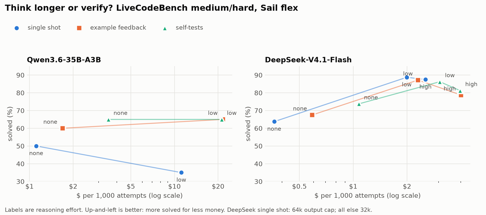

# agent-lab

Small, reproducible experiments on how open-model agents behave. Each one asks a single question,
runs it on Sail Research's API, and keeps the raw responses in `runs/` so every number can be checked.

## Experiment 1: which feedback loop helps a model fix its own code?


12 coding tasks, each with a spec, public examples the model sees, and hidden tests it never sees.
3 models (GLM-5.3-Flash, DeepSeek-V4.1-Flash, gpt-oss-120b) x 3 repeats, up to 3 turns per attempt.
Every turn is graded on the hidden tests, so turn 1 and the final turn come from the same attempt.

| harness | turn 1 | final | fixed | broken |
|---|---|---|---|---|
| example failures fed back | 96/108 | 100/108 | 4 | 0 |
| own tests first, model judges each failure | 95/108 | 106/108 | 11 | 0 |
| own tests first, blind retry on failure | 91/108 | 101/108 | 12 | 2 |

Caveats: the task set is small and DeepSeek passes everything, turn 1 varies by about 4/108 between runs
of the same prompt, and the self-test harnesses cost about 3.5x the tokens of the example harness.

## Experiment 2: think longer or verify?



For a reasoning model writing code, is it better to spend tokens thinking (`reasoning_effort`) or checking
the code against tests afterwards? 40 LiveCodeBench problems (medium and hard, AtCoder and LeetCode,
released Jan-Apr 2025), graded on hidden tests, run on Sail's `flex` window. Cost is real flex pricing.

DeepSeek-V4.1-Flash, 80 attempts per row (40 problems x 2 repeats):

| effort | single shot | + example feedback | + self-tests | single shot $ / 1k attempts |
|---|---|---|---|---|
| none | 64% | 68% | 74% | $0.36 |
| low | 89% | 87% | 86% | $1.99 |
| high | 88% | 79% | 81% | $2.54 |

- Turning reasoning on (none -> low) adds about 25 points. The best verification without reasoning adds 10.
- Verification helps only when the model is not reasoning; on top of `low` it adds nothing measurable.
- `high` matches `low` at about 28% more cost. Under a 32k output cap, `high` scored 75%: it ran out of room
  on 17 of 80 attempts. The single-shot column uses a 64k cap (the capped attempts were rerun, see
  `runs/lcb_20261024-165600_examples.jsonl`); the feedback columns are from the 32k run.

Qwen3.6-35B-A3B on the 20 medium problems (n=20, indicative only): `low` effort used about 50k reasoning
tokens per attempt, cost 10x `none`, and scored lower single-shot (35% vs 50%) because it hit the cap.

Caveats: one main model; problems predate the models, so absolute scores may include training-data leakage;
about ±5 points of noise at n=80; at effort `none` the self-test prompt made the model skip the code in 10 of
80 replies; 2 attempts lost a later turn to an API error and are counted only for single shot.

## Files

- `tasks.py`: the 12 tasks, graders, and test runners. `uv run tasks.py` self-checks every grader.
- `run.py`: the harness. `--harness examples | selftest | resample`.
- `plot.py`: rebuilds the chart from run files.
- `bench.py`: one prompt timed on Sail's `asap` and `balanced` completion windows.
- `lcb.py`: LiveCodeBench loading and grading. `uv run lcb.py --download` fetches the data into `data/`.
- `run_lcb.py`: experiment 2 runner on Sail flex (background Responses, polled), with a per-run budget cap.
- `plot_lcb.py`: rebuilds the experiment 2 chart from run files.

## Run

```bash
export SAIL_API_KEY=...   # https://app.sailresearch.com/api-keys
uv run tasks.py
uv run run.py --harness selftest --models zai-org/GLM-5.3-Flash --repeats 1 -k semver
uv run plot.py runs/*_asap.jsonl -o harnesses.png
```
